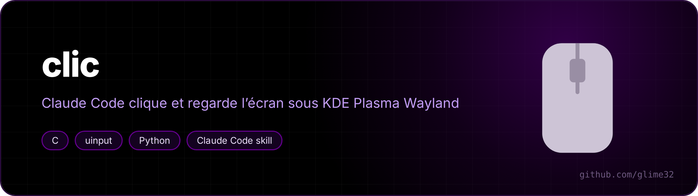
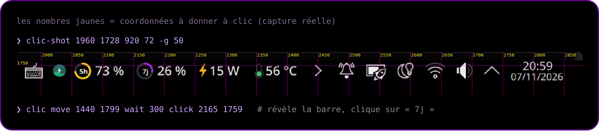
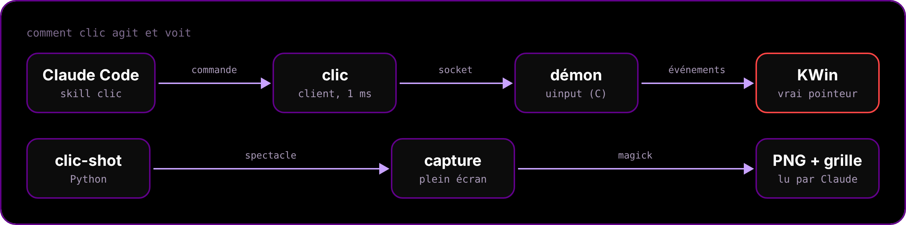

<p align="center"></p>

<p align="center">   </p>

<p align="center"><a href="README.md">🇬🇧 English version</a></p>

**Un skill [Claude Code](https://claude.com/claude-code) qui permet à Claude de cliquer sur un bureau KDE Plasma (Wayland) et de regarder le résultat, pour tester lui-même une interface : ouvrir le popup d'un widget, appuyer sur un bouton, vérifier qu'un clic fait bien ce qu'il faut.**

Sous Wayland, pas de `xdotool` : `clic` est une petite souris virtuelle faite avec `uinput`, et `clic-shot` prend une capture d'écran avec une grille de coordonnées dessinée dessus, pour que Claude vise au pixel près.

<p align="center"></p>

## Commandes

| Commande `clic` | Effet |
|---|---|
| `move X Y` | survoler |
| `click X Y [left\|right\|middle]` | cliquer |
| `dclick X Y` / `rclick X Y` | double-clic / clic droit |
| `down X Y` / `up X Y` | appuyer / relâcher |
| `drag X1 Y1 X2 Y2` | glisser-déposer |
| `scroll X Y N` / `hscroll X Y N` | molette (N > 0 = vers le bas / la droite) |
| `wait MS` | pause |
| `ping` / `quit` | vérifier / arrêter le démon |

Les commandes s'enchaînent en un seul appel : `clic move 1440 1799 wait 300 click 2165 1759`.

`clic-shot` capture tout l'écran (réduit, grille tous les 200 px) ; `clic-shot X Y L H` zoome sur une zone avec une grille plus fine ; `-r` réutilise la dernière capture pour zoomer encore sans recapturer.

## Comment ça marche

<p align="center"></p>

- Le pointeur est un périphérique **absolu** (comme la tablette d'une machine virtuelle) : une position en pixels d'écran est atteinte exactement, sans accélération.
- Le démon garde le périphérique ouvert : une commande prend environ 1 ms. Le client le lance au premier appel (~0,3 s) et il s'arrête après 15 minutes sans usage. Aucun service à activer.
- Bords de l'écran : KWin n'active un bord (barre auto-masquée, coin actif) que si le pointeur pousse deux fois dessus. `clic` fait cette poussée tout seul quand la cible est sur un bord.

## Installation

Il faut `gcc`, `spectacle`, ImageMagick (`magick`), `kscreen-doctor`, et le droit d'écrire dans `/dev/uinput` (sur beaucoup de distributions, les paquets Steam ou KDE Connect le donnent déjà à l'utilisateur connecté ; vérifie avec `getfacl /dev/uinput`).

```bash
git clone https://github.com/glime32/clic ~/.claude/skills/clic
sh ~/.claude/skills/clic/scripts/install.sh
```

Claude Code trouve le skill dans `~/.claude/skills/clic/SKILL.md`. Les commandes sont installées dans `~/.local/bin`.

> [!WARNING]
> C'est ton vrai pointeur qui bouge. Le skill demande à Claude de rester bref, de te prévenir avant de cliquer, et de ne jamais cliquer sur une action destructive ou une demande d'autorisation sans ton accord.
