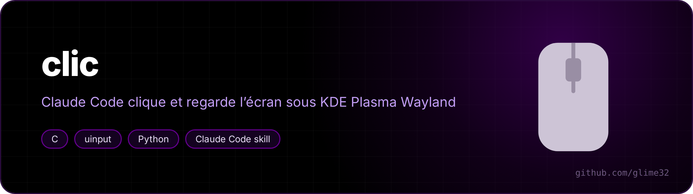
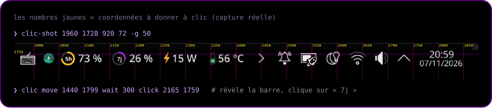
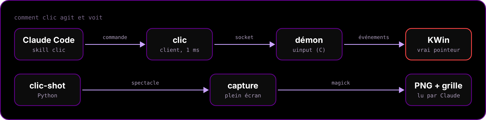

<p align="center"></p>

<p align="center">   </p>

<p align="center"><a href="README.fr.md">🇫🇷 Version française</a></p>

**A [Claude Code](https://claude.com/claude-code) skill that lets Claude click on a KDE Plasma (Wayland) desktop and look at the result, to test GUI changes by itself: open a widget's popup, press a button, check that a click does the right thing.**

Wayland gives no `xdotool`, so `clic` is a tiny virtual mouse made with `uinput`, and `clic-shot` takes a screenshot with a coordinate grid printed on it, so Claude can aim at the pixel.

<p align="center"></p>

## Commands

| `clic` command | Effect |
|---|---|
| `move X Y` | hover |
| `click X Y [left\|right\|middle]` | click |
| `dclick X Y` / `rclick X Y` | double-click / right-click |
| `down X Y` / `up X Y` | press / release |
| `drag X1 Y1 X2 Y2` | drag and drop |
| `scroll X Y N` / `hscroll X Y N` | wheel (N > 0 = down / right) |
| `wait MS` | pause |
| `ping` / `quit` | check / stop the daemon |

Commands chain in one call: `clic move 1440 1799 wait 300 click 2165 1759`.

`clic-shot` grabs the whole screen (scaled down, grid every 200 px); `clic-shot X Y W H` zooms on a region with a finer grid; `-r` reuses the last capture to zoom again without re-grabbing.

## How it works

<p align="center"></p>

- The pointer is an **absolute** device (like a VM tablet), so a position in screen pixels is reached exactly, with no mouse acceleration.
- The daemon keeps the device open: a command takes about 1 ms. The client starts it on the first call (~0.3 s) and it quits after 15 minutes of idle time. No service to enable.
- Screen edges: KWin only triggers an edge (auto-hidden panel, hot corner) when the pointer pushes twice against it. `clic` does that push automatically when a target is on a border.

## Install

Needs `gcc`, `spectacle`, ImageMagick (`magick`), `kscreen-doctor` and write access to `/dev/uinput` (on many distros the Steam or KDE Connect packages already grant it to the logged-in user; check with `getfacl /dev/uinput`).

```bash
git clone https://github.com/glime32/clic ~/.claude/skills/clic
sh ~/.claude/skills/clic/scripts/install.sh
```

Claude Code picks the skill up from `~/.claude/skills/clic/SKILL.md` (written in French, like the rest of the tool). The commands are installed in `~/.local/bin`.

> [!WARNING]
> It moves your real pointer. The skill tells Claude to keep it short, to warn you before clicking, and never to click anything destructive or a permission prompt without your OK.
